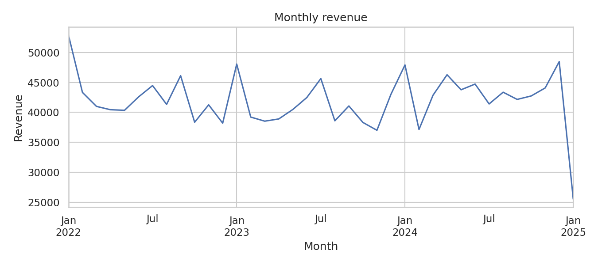
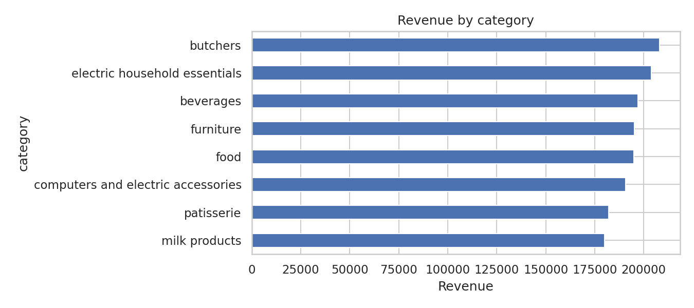
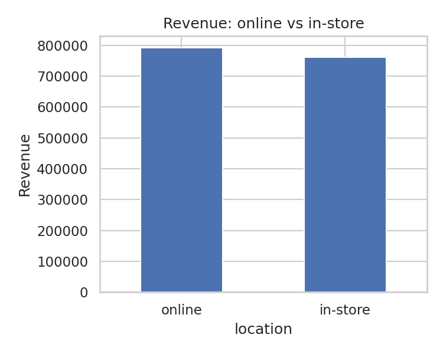

# Retail Store Sales Analysis | Python, Pandas & Data Visualization

End-to-end exploratory data analysis of 11,971 retail transactions (Jan 2022 – Jan 2025): data cleaning, revenue analysis by category, payment method, location and month, with visualizations and business insights.

## Business Questions

- Which product categories generate the most revenue?
- How do online and in-store sales compare?
- Which payment methods are used most?
- How does revenue change over time, and is there a seasonal pattern?
- Which items sell best?

## Key Insights

- **Total revenue: 1,552,071** across 37 months, from 11,971 cleaned transactions (average about 130 per transaction).
- **Revenue is spread evenly across categories.** Butchers is highest at 13.4% (208,118) and milk products lowest at 11.6% (180,112), a gap of only 1.8 percentage points. No single category dominates.
- **Online and in-store are almost equal:** online 51.0% (791,401) vs in-store 49.0% (760,670).
- **Cash is the most used payment method at 34.6%** (537,710); digital wallet and credit card are tied at 32.7% each.
- **January is the strongest month.** Adjusted for the number of days of data in each month, January's daily revenue is about 13% above the overall daily average, while every other month is within 8% of it.
- **Top-selling item:** Item_25_FUR (25,256 in revenue).

## Dataset

- 12,575 rows and 11 columns: transaction ID, customer ID, category, item, price per unit, quantity, total spent, payment method, location, transaction date, discount applied
- Date range: 2022-01-01 to 2025-01-18 (37 months)


## Data Cleaning

| Issue | Count | Treatment |

| Missing `item` | 1,213 | Labeled `unknown` and excluded from item rankings |
| Missing `discount_applied` | 4,199 (33%) | Labeled `unknown` instead of assuming False |
| Missing `price_per_unit` | 609 | Rebuilt as total ÷ quantity where possible |
| Missing `quantity` | 604 | Rebuilt as total ÷ price where possible |
| Missing `total_spent` | 604 | Rebuilt as price × quantity where possible |
| Rows still missing 2+ numeric values | 604 (4.8%) | Dropped |
| Duplicate rows | 0 | None found |
| Outliers (IQR rule) | 60 | Kept, because high totals are valid large orders |

Final dataset: 11,971 rows, no missing values.

## Visualizations





## Tech Stack

- **Language:** Python
- **Libraries:** Pandas, NumPy, Matplotlib, Seaborn

## Workflow

1. Data loading and inspection
2. Data cleaning (missing values, duplicates, outliers, data types)
3. Aggregation by category, payment method, location, month and item
4. Visualization
5. Insights and recommendations

## How to Run

```bash
git clone https://github.com/sankalplohe-ai/retail-sales-analysis.git
cd retail-sales-analysis
pip install pandas numpy matplotlib seaborn
jupyter notebook
```

Open `retail_store_sales_project.ipynb`. The dataset `retail_store_sales.csv` must be in the same folder.

## Recommendations

- Since categories perform similarly, a balanced inventory across categories is reasonable. Butchers and electric household essentials are the best performers and milk products and patisserie the weakest, so those two are the first to review for promotions.
- January outperforms other months, so planning stock and promotions for it may pay off.
- Online and in-store contribute equally, so both channels deserve investment.

## Author

Sankalpa Ratnabodhi · sankalplohe@gmail.com · [LinkedIn](https://www.linkedin.com/in/sankalpa-mahendra-ratnabodhi-lohe-88098b200)
